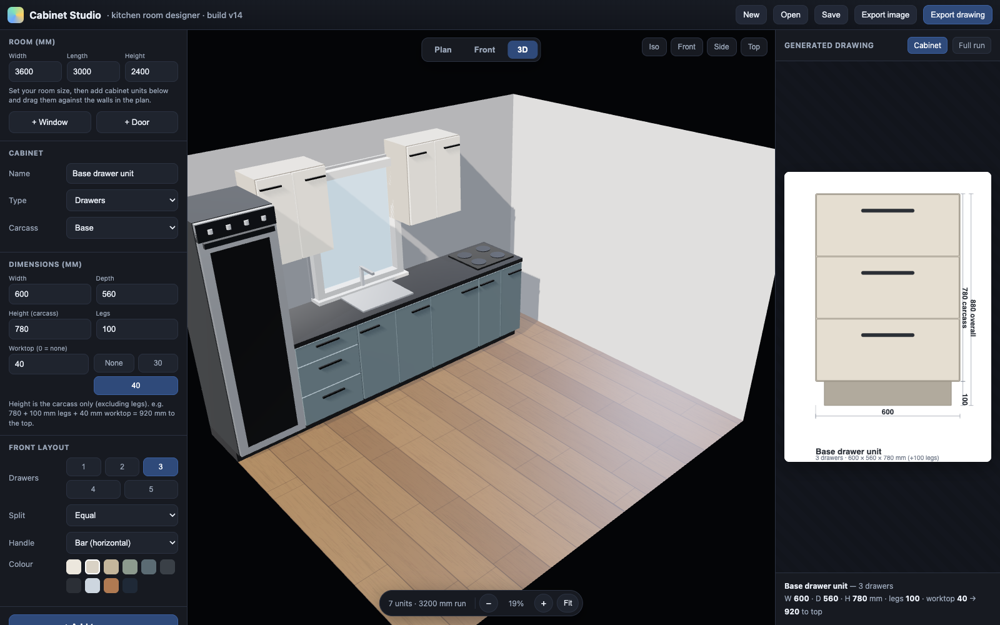

# Cabinet Studio — kitchen designer that outputs shop drawings

**Design the room in 3D, get the dimensioned cabinet drawing out the other end.**
One HTML file, three.js, no build step.



## Why this exists

Kitchen planners aimed at customers produce a pretty picture and a price. What the workshop
needs is the *drawing* — carcass height, leg height, worktop thickness, the 920 mm to the top,
how many drawers and where the splits fall.

So this does both: the customer sees the room, and the same model generates the sheet the
workshop builds from.

## What it does

**Room plan** — set room dimensions and draw room outlines in centimetres or inches. While
tracing a free-form outline, enter an exact segment length and angle (or draw it with the mouse);
interior walls can likewise be drawn endpoint-to-endpoint or placed from an exact length and angle.
All dimensions remain stored internally in millimetres. Add windows and doors, then drag units in
from the catalogue and snap them against the walls.

**Three views** — Plan, Front elevation, and a **3D view with PBR materials** you can orbit.
Wood floor, worktop, appliance and carcass materials are shaded properly, so the 3D view is
presentable to a customer rather than just a massing check.

**Floor finish zones** — draw separate areas on the plan, choose a surface image from the `Tuile`
gallery, and set 24 × 24 in, 12 × 24 in, 24 × 48 in, or custom tile dimensions. Choose horizontal
or vertical direction and a straight, parquet, half-parquet, 1/3–2/3, L, herringbone, vertical-center,
45° diagonal or brick arrangement. The selected tile image and arrangement appear in the plan and
3D view, with adjustable grout width. The tile estimate counts each tile intersected by the zone as
a whole tile (cut pieces are not reused) and adds 20% extra. Optional box coverage and price give a
box count and material-cost estimate; tax and installation are excluded. Zone details are included
in saved projects.

**Walls and columns** — place independent interior walls and columns from the Plan, adjust their
dimensions, position and freely chosen angle, and apply paint colours or tile-image finishes to
them. Draw rectangular ceramic areas on room walls, interior-wall faces or column faces in a
dimensioned wall elevation. Room perimeter walls can also be finished individually. Wall, column
and ceramic-area details are included in saved projects.

**Paint and primer estimate** — estimate two paint coats by wall/ceiling colour and one primer coat
shared across all painted surfaces. Choose the ceiling colour manually; the ceiling area is included
automatically, and door and window openings are deducted from walls. Compare 3.78 L-only, 18.9 L-only
and the least-cost mixed package purchase for each paint colour and for the shared primer. The
coverage rate is editable (default 10 m²/L per coat); prices are the user-provided estimates and do
not include tax or labour.

**Drywall layout** — compare 1/2 in, 4 × 8 ft gypsum-sheet directions and stagger patterns across
perimeter walls, the ceiling, interior wall faces and column faces. Door and window openings are
deducted from net wall area and their cut edges are counted. The selected pattern strictly minimizes
estimated cuts first, then aligned butt joints and total joint length. It searches both sheet
orientations, regular stagger offsets, and critical offsets at opening and outline edges. Sheet
quantities use net area plus a configurable ordering allowance; they are not a sheet-by-sheet
offcut nesting plan. Print or save the drawings as PDF, then verify framing, offcut fit and local
requirements on site.

**The cabinet panel** — pick a unit and set type (drawers, doors, open), carcass type,
dimensions, leg height, worktop thickness, front layout (1–5 drawers, equal or custom split),
handle style and colour.

**Bathroom catalogue** — add adjustable vanity, toilet and bathtub placeholders, or import a
self-contained GLB model that you are authorized to use. Imported models are measured in metres,
converted to millimetres for the room plan, and rescaled to the editable dimensions. The GLB is
stored locally and embedded in exported project JSON so the model travels with the project.
Vanity entries link to IKEA Canada for product inspiration, but Cabinet Studio does not search
IKEA's internal APIs. The optional `ikea-3d-model-downloader.user.js` helper adds a download button
beside the 3D viewer on IKEA product pages and saves a GLB to the user's device. It runs on IKEA
pages and observes client-side product navigation, so its button is recreated when IKEA changes
products without a full page load. The user must install/update the helper and allow Tampermonkey
site access for IKEA in browser extension settings. Products that do
not load a 3D model cannot be downloaded with the helper. The helper runs in the user's browser and
does not send model data to Cabinet Studio or a third-party server. Use it only for models you are
authorized to download and reuse. Toilet and bathtub placeholders are generic. The 3D view uses a
cutaway that hides the nearest room walls so fixtures remain visible. Confirm real product
dimensions and availability before purchasing or installation.

**Generated drawing** — the right-hand panel draws the selected cabinet dimensioned, or the
full run, and states the arithmetic that people get wrong:

> 780 carcass + 100 legs + 40 worktop = **920 mm** to the top

**Export** — the plan, the drawing, and a high-resolution render of the 3D view.

## Built with

[three.js](https://threejs.org) for the 3D view with PBR materials and shadow mapping, its
matching GLTFLoader and DRACOLoader for local GLB imports (including Draco-compressed geometry),
HTML Canvas for the plan and the generated drawing, vanilla JavaScript throughout. The Draco
decoder files are in `lib/`; their license is included in `lib/DRACO-LICENSE.txt`. ~3,700 lines in
a single file; drag-and-drop from catalogue to plan; hi-res export renders off-screen at a
larger size than the viewport. The Three.js license is included in `lib/THREE-LICENSE.txt`.

### Installing the IKEA model helper

1. Install the Tampermonkey browser extension and allow it to run on IKEA sites (`ikea.com`) in
   the browser's extension site-access settings.
2. In Cabinet Studio, click **Download IKEA 3D helper** and open the downloaded `.user.js` file
   with Tampermonkey to install or update it. If your browser does not offer that option, open the
   Tampermonkey dashboard and import the file.
3. Open an IKEA product page with a 3D viewer and use **Download 3D model** beside the viewer. The
   helper follows IKEA's in-page product navigation.
4. Return to Cabinet Studio and import the downloaded `.glb` file. Import the `.glb` model, not the
   `.user.js` helper script.

## Run it

```bash
python3 -m http.server 8080     # then open http://localhost:8080/
```

It's a static page — any web server will do, or open `index.html` directly.
